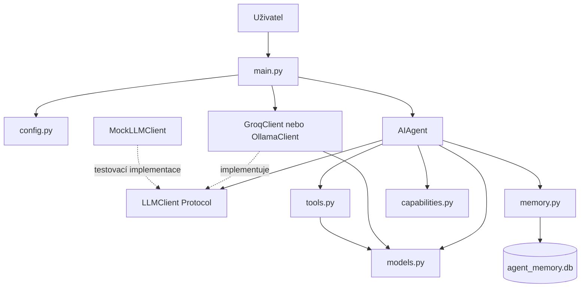
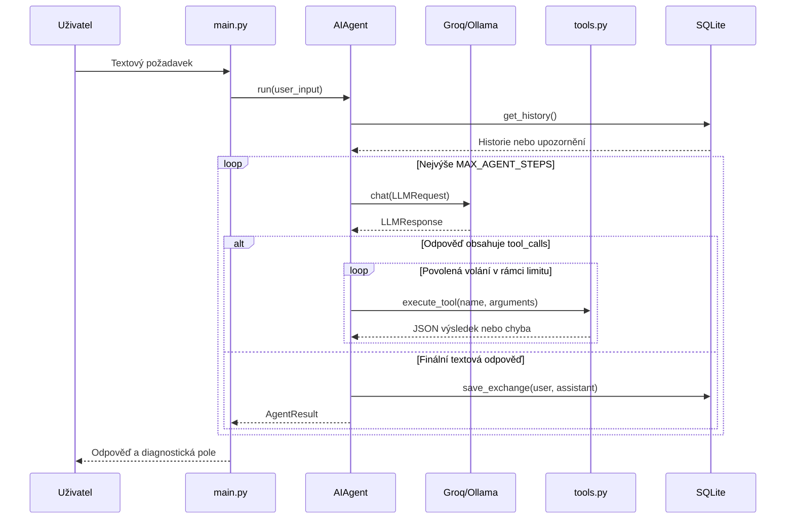

# Architektura AI agenta

## 1. Účel a aktuální rozsah

Aplikace je konzolový AI agent v Pythonu. Jejím hlavním architektonickým cílem je oddělit rozhodovací logiku agenta od konkrétního poskytovatele jazykového modelu a umožnit testování bez skutečné síťové komunikace.

Aktuální implementace je **jeden agent s omezeným Agent Loop a třemi nástroji**. Není to multiagentní systém (MAS) ani specializovaný programátorský agent.

Použité principy:

- **Separation of Concerns:** agent, adaptéry LLM, nástroje, paměť a konfigurace mají oddělené odpovědnosti.
- **Dependency Injection:** `AIAgent` dostává LLM klienta zvenčí a sám nevybírá poskytovatele.
- **Provider neutrality:** interní komunikace používá vlastní datové třídy, nikoliv datové struktury Groq nebo Ollama.
- **KISS:** projekt používá standardní knihovnu Pythonu, funkce a dataclasses bez agentního frameworku.
- **Testovatelnost:** `MockLLMClient` umožňuje ověřovat rozhodovací logiku bez skutečného LLM.

## 2. Komponenty a odpovědnosti

| Soubor | Odpovědnost |
|---|---|
| `main.py` | Vstupní bod, výběr LLM klienta, logování a konzolová smyčka. |
| `config.py` | Cesty, poskytovatelé, modely, limity, system prompt a deklarované funkce. |
| `agent/agent.py` | Agent Loop, sestavení kontextu, volání nástrojů a strukturovaný výsledek běhu. |
| `agent/models.py` | Provider-neutrální datový kontrakt. |
| `agent/llm_client.py` | `LLMClient` Protocol, společné výjimky a adaptér Ollama. |
| `agent/groq_client.py` | Adaptér Groq Chat Completions API. |
| `agent/retry.py` | Validace HTTP nastavení, klasifikace dočasných chyb a výpočet prodlev. |
| `agent/tools.py` | Implementace, registr, definice a vykonávání nástrojů. |
| `agent/memory.py` | Historie konverzace v SQLite. |
| `agent/capabilities.py` | Generování katalogu schopností a kontextu pro LLM. |
| `agent/mock_llm_client.py` | Deterministický klient pro testování. |
| `scripts/generate_capabilities.py` | Samostatný příkaz pro generování `CAPABILITIES.md`. |
| `tests/` | Jednotkové testy agenta, adaptérů, paměti a nástrojů. |

## 3. Závislosti mezi komponentami



`LLMClient` je `Protocol`, tedy strukturální rozhraní. Konkrétní klient nemusí dědit ze společné základní třídy; musí poskytovat kompatibilní metodu `chat(request)`, která vrací `LLMResponse`.

## 4. Provider-neutrální datový kontrakt

Interní datové třídy jsou definovány v `agent/models.py`.

### `ChatMessage`

Reprezentuje zprávu konverzace:

- `role`: `system`, `user`, `assistant` nebo `tool`;
- `content`: text zprávy, případně `None`;
- `tool_calls`: seznam požadavků asistenta na spuštění nástrojů;
- `tool_call_id`: identifikátor volání, ke kterému patří výsledek;
- `name`: název nástroje u výsledkové zprávy.

### `ToolCall`

Jedno volání nástroje požadované modelem:

- `id`: identifikátor volání;
- `name`: název nástroje;
- `arguments`: argumenty jako slovník.

### `ToolDefinition`

Provider-neutrální popis nástroje:

- `name`: název;
- `description`: popis účelu;
- `parameters`: schéma parametrů ve formátu JSON Schema.

### `LLMRequest` a `LLMResponse`

`LLMRequest` obsahuje seznam zpráv a volitelný seznam definic nástrojů. `LLMResponse` obsahuje text odpovědi a/nebo seznam požadavků na volání nástrojů.

### Rozhraní `LLMClient`

```python
class LLMClient(Protocol):
    def chat(self, request: LLMRequest) -> LLMResponse:
        ...
```

Agent předává adaptéru interní `LLMRequest` a očekává normalizovaný `LLMResponse`. Převod do formátu konkrétního API patří adaptéru.

## 5. Adaptéry jazykových modelů

### Groq – `agent/groq_client.py`

- Používá Groq Chat Completions API na endpointu `GROQ_URL`.
- Výchozí model je `openai/gpt-oss-120b`; lze jej změnit proměnnou prostředí `GROQ_MODEL`.
- API klíč načítá z `GROQ_API_KEY`.
- Převádí interní zprávy a definice nástrojů do OpenAI-kompatibilního formátu.
- Normalizuje text a volání nástrojů na `LLMResponse` a `ToolCall`.

### Ollama – `agent/llm_client.py`

- Volitelný lokální adaptér.
- Výchozí endpoint je `http://localhost:11434/api/chat`.
- Výchozí model je `qwen3:1.7b`.
- Převádí interní datové struktury na formát Ollama Chat API.
- Pokud odpověď neobsahuje ID volání nástroje, vytvoří lokální identifikátor.

### Chybové stavy a opakování

`LLMError` je společná základní výjimka. Podtypy `ToolValidationError`, `RateLimitError` a `ProviderError` rozlišují chyby validace volání nástrojů, limity poskytovatele a ostatní chyby API.

Modul `agent/retry.py` centralizuje:

- opakování HTTP 408, 429 a 5xx;
- opakování síťových chyb `OSError`;
- exponenciální prodlevu s horním limitem 30 sekund;
- respektování platné hlavičky `Retry-After`, rovněž omezené na 30 sekund;
- validaci timeoutu a počtu opakování.

Výchozí `max_retries=2` znamená nejvýše tři pokusy. Konstruktor povoluje 0 až 5 opakování. Výchozí timeout je 60 sekund pro Groq a 120 sekund pro Ollama; povolený rozsah je větší než 0 a nejvýše 300 sekund. Timeout se vztahuje na jeden HTTP požadavek, nikoliv na celý běh agenta.

Groq navíc:

- klasifikuje `tool_use_failed` nebo `Tool call validation failed` jako `ToolValidationError` a stejný požadavek neopakuje;
- rozpoznává HTTP 413 jako limit TPM pouze tehdy, když tělo chyby obsahuje indikaci `tokens per minute`, `TPM` nebo `token limit`;
- pro rozpoznaný TPM limit používá delší exponenciální prodlevu od 10 sekund, nejvýše 30 sekund;
- obecnou HTTP 413 neopakuje.

Opakování POST požadavku po nejednoznačné síťové chybě může v krajním případě vyvolat další generaci a spotřebovat další API usage. Proto je počet opakování omezen.

## 6. Tok jednoho požadavku

1. `main.py` načte `LLM_PROVIDER` a vytvoří `GroqClient` nebo `OllamaClient`.
2. Vytvoří `AIAgent` a předá mu klienta. `AIAgent` vyžaduje explicitně předaný LLM klient; paměť lze předat volitelně.
3. Uživatel zadá požadavek v konzoli.
4. `AIAgent.run()` ověří vstup a sestaví kontext ze system promptu, katalogu schopností, dostupné historie a aktuální zprávy.
5. Agent vytvoří `LLMRequest` a zavolá `llm_client.chat()`.
6. Adaptér převede požadavek do formátu svého API a odešle jej poskytovateli.
7. Adaptér normalizuje odpověď na `LLMResponse`.
8. Pokud odpověď obsahuje `tool_calls`, agent předá každé povolené volání registru nástrojů.
9. Výsledky nástrojů přidá jako zprávy role `tool` do dočasného kontextu a znovu zavolá model.
10. Jakmile model vrátí neprázdný text bez dalších volání nástrojů, agent vytvoří `AgentResult` a pokusí se uložit uživatelský vstup a finální odpověď do SQLite.



Při chybě inicializace, načtení nebo uložení SQLite paměti agent pokračuje bez historie nebo bez uložení a vrací samostatné `memory_warning`.

## 7. Agent Loop, limity a výsledek

Agent Loop je implementován v `AIAgent.run()`.

Výchozí limity v `config.py`:

| Konstanta | Hodnota | Význam |
|---|---:|---|
| `MAX_AGENT_STEPS` | 8 | Maximální počet požadavků modelu v jednom běhu. |
| `MAX_TOOL_CALLS` | 12 | Maximální počet vykonaných volání nástrojů v jednom běhu. |
| `MAX_HISTORY_MESSAGES` | 12 | Počet posledních záznamů historie načítaných z SQLite. |
| `MAX_FILE_SIZE` | 100 000 bajtů | Maximální velikost souboru načteného nástrojem `read_file`. |
| `MAX_LIST_FILES` | 100 | Maximální počet položek výpisu souborů. |
| `MAX_TOOL_RESULT_CHARS` | 8 000 znaků | Limit serializovaného výsledku jednoho nástroje. |
| `MAX_TOTAL_TOOL_RESULT_CHARS` | 16 000 znaků | Souhrnný rozpočet výsledků nástrojů v jednom běhu. |
| `max_retries` | 2 (rozsah 0–5) | Počet opakování po prvním HTTP pokusu. |
| `timeout` | 60 s Groq / 120 s Ollama | Výchozí timeout jednoho HTTP požadavku. |
| `MAX_RETRY_DELAY_SECONDS` | 30 s | Maximální prodleva mezi běžnými opakováními. |

Limity kroků a volání nástrojů jsou nezávislé. Počet volání nástrojů počítá skutečně vykonaná volání, nikoliv počet cyklů.

`AgentResult` obsahuje:

- `status`: `completed`, `error` nebo `limit_reached`;
- `answer`: text vrácený uživateli;
- `tool_calls`: počet vykonaných volání nástrojů;
- `error`: doplňující chybový popis;
- `error_type`: diagnostická kategorie;
- `tool_errors`: počet výsledků nástrojů obsahujících chybu;
- `memory_warning`: upozornění na problém s pamětí.

Pokud model obdrží chybu nástroje a přesto vytvoří finální text, může být výsledek `status="completed"` a současně `error_type="tool_execution_error"`. Znamená to pouze dokončení Agent Loop, nikoliv úspěšné provedení všech dílčích operací.

## 8. Nástroje a jejich bezpečnostní hranice

Nástroje jsou definovány v `agent/tools.py`.

### `calculator`

Podporuje operace `add`, `subtract`, `multiply` a `divide`. Ověřuje typ a rozsah čísel, odmítá booleovské hodnoty a dělení nulou. Nepodporuje mocniny ani odmocniny.

### `list_files`

Vrací relativní cesty souborů z `workspace/`, příznak `truncated` a limit `max_results`. Vrací nejvýše `MAX_LIST_FILES` položek. Používá omezený výběr nejmenších cest a ignoruje symbolické odkazy na soubory i adresáře.

### `read_file`

Čte běžné UTF-8 soubory z `workspace/`. Odmítá absolutní cesty, průchod do nadřazeného adresáře a symbolické odkazy. Obsah načítá binárně nejvýše do `MAX_FILE_SIZE + 1` bajtů, aby rozpoznal překročení limitu. Na systémech podporujících `O_NOFOLLOW` odmítne symbolický odkaz také při otevření poslední komponenty.

### Registr a vykonání

- `AVAILABLE_TOOLS` mapuje názvy na implementace Python funkcí.
- `TOOL_DEFINITIONS` obsahuje provider-neutrální popisy a JSON Schema parametrů.
- `execute_tool()` ověřuje název a typ argumentů, vykoná pouze registrovanou funkci a vrací JSON s `result` nebo `error`.

Model navrhuje volání nástroje, ale samotné vykonání provádí Python aplikace podle pevného registru. Tímto rozhraním model nemůže spustit libovolnou funkci.

`execute_tool()` převádí očekávané chyby na JSON. Neočekávané výjimky zaznamená do logu a nahradí bezpečnou chybovou zprávou. `AIAgent` má navíc ochrannou hranici kolem volání registru.

Výstup jednoho nástroje se omezuje na `MAX_TOOL_RESULT_CHARS`. U výpisu souborů se zkracují položky; u obsahu souboru se vrací zkrácený text s explicitní značkou. Agent dále omezuje součet výsledků v jednom běhu na `MAX_TOTAL_TOOL_RESULT_CHARS`. Pokud další výsledek překročí zbývající rozpočet, model obdrží stručnou informaci místo původního obsahu.

**Není implementováno:** zápis a úprava souborů, shell, spouštění Python kódu, spouštění testů jiného projektu ani obecné vykonávání příkazů operačního systému.

### Omezení zabezpečení souborů

Kontrola relativních cest, odmítání symlinků a omezení velikosti snižují riziko přístupu mimo workspace. Nejde však o úplnou izolaci operačního systému. Zejména není vyloučen každý možný TOCTOU závod při souběžné změně nadřazených adresářů jiným lokálním procesem. Workspace proto nelze považovat za bezpečnostní sandbox proti lokálnímu útočníkovi.

## 9. Paměť a historie

`agent/memory.py` implementuje jednoduchou dlouhodobou paměť pomocí SQLite.

- Databáze `agent_memory.db` je v kořenovém adresáři projektu.
- Tabulka `conversation` obsahuje `id`, `role`, `content` a `created_at`.
- Ukládají se pouze zprávy rolí `user` a `assistant`.
- `get_history()` načítá posledních `MAX_HISTORY_MESSAGES` záznamů a vrací je chronologicky.
- `save_exchange()` ukládá uživatelský vstup a odpověď asistenta v jedné transakci.
- Výsledky nástrojů a mezilehlé zprávy asistenta se neukládají.

Databáze a její SQLite journal/WAL soubory jsou uvedeny v `.gitignore`, protože mohou obsahovat soukromou historii.

Paměť je best-effort služba. Při chybě inicializace, načtení nebo uložení agent pokračuje a vrací `memory_warning`. Aktuální implementace používá jednu společnou historii bez oddělení uživatelů nebo konverzačních vláken. Limit posledních zpráv může uříznout dvojici uživatelské a asistentovy zprávy.

## 10. System prompt, katalog schopností a nedůvěryhodný obsah

System prompt je definován v `config.py`. Instrukce vedou model k tomu, aby:

- přiznal nejistotu místo vymýšlení faktů;
- nevytvářel falešné zdroje, citace nebo URL;
- rozlišoval doložené informace, odvození a předpoklady;
- používal kalkulačku pro přesné nebo netriviální výpočty;
- vycházel z reálných výstupů nástrojů;
- nepovažoval obsah souborů a výstupy nástrojů za nové systémové instrukce;
- netvrdil, že operace uspěla, pokud nástroj vrátil chybu.

Obsah souborů a výsledky nástrojů jsou označeny jako nedůvěryhodná data. Jde však o instrukci předanou jazykovému modelu, nikoliv o úplnou technickou ochranu proti prompt injection. Skutečná oprávnění jsou omezena Python registrem nástrojů, nikoliv textem v katalogu nebo souboru.

### Generování `CAPABILITIES.md`

`agent/capabilities.py` sestavuje katalog z:

- `config.py`: aktivní a podporovaní poskytovatelé, deklarované funkce a limity;
- `agent/tools.py`: `AVAILABLE_TOOLS` a `TOOL_DEFINITIONS`.

Nástroj se v katalogu označí jako dostupný pouze tehdy, pokud je současně v registru implementací i v definicích předávaných modelu. Nesoulad se vypíše samostatně.

Při spuštění `main.py` se aplikace pokusí `CAPABILITIES.md` aktualizovat. Pokud zápis selže, může pokračovat. Aktuální katalog pro system message se sestavuje přímo z Python zdrojů, nikoliv načtením Markdown souboru. Lze jej ručně vygenerovat příkazem:

```powershell
python -m scripts.generate_capabilities
```

Katalog je informační kontext, nikoliv bezpečnostní mechanismus. Samotný soubor `CAPABILITIES.md` nemění skutečná oprávnění.

## 11. Hranice ověřování a známé chování

Agent nemá internetové vyhledávání ani přístup k externím zdrojům. Nemůže proto nezávisle ověřovat aktuální události nebo obecná faktická tvrzení.

Ověření je omezeno na konkrétní výstupy nástrojů:

- `calculator` provádí výpočty deterministicky v Pythonu;
- `read_file` vrací skutečný obsah souboru z workspace;
- výsledkové zprávy nástrojů jsou předány modelu v dalším požadavku;
- testy ověřují předání výsledků i při více voláních v jednom cyklu.

Agent neprovádí nezávislou sémantickou kontrolu finální odpovědi. Nemá strukturovanou evidenci, která by spojovala uživatelský požadavek, plánované kroky, skutečná volání nástrojů, jejich argumenty a výstupy s důkazem splnění jednotlivých kritérií.

Proto platí:

- `tool_calls` je počet vykonaných volání nástrojů, nikoliv důkaz, že byl požadovaný úkol splněn;
- `tool_errors` počítá neúspěšné výsledky nástrojů, ale nehodnotí úplnost finální odpovědi;
- `completed` znamená, že Agent Loop obdržel neprázdnou finální textovou odpověď;
- `completed` **neznamená**, že výsledek je fakticky správný nebo že byly splněny všechny části zadání.

Při vývojovém testu více navazujících výpočtů agent vykonal oba výpočty, ale model ve finální odpovědi uvedl pouze druhý výsledek. Jde o příklad toho, že správné provedení nástrojů nezaručuje úplnost syntézy modelu.

V jiném testu páté odmocniny model odvodil kandidátní výsledek sám a kalkulačkou pouze ověřil jeho pátou mocninu. Agent přesto popsal úlohu tak, jako by ji vyřešil nástrojem. Kalkulačka navíc nemá operaci mocniny ani odmocniny. To ukazuje, že současný systém nedokáže spolehlivě rozlišit, zda nástroj úlohu skutečně vyřešil, nebo pouze ověřil kandidát odvozený modelem. Nevede ani dostatečně přísnou auditní evidenci počtu a účelu dílčích volání.

System prompt může takovému chování předcházet instrukcemi, ale negarantuje jeho odstranění. Stav běhu a počet volání proto nelze používat jako samostatný důkaz správnosti.

## 12. Testování

Testy jsou organizovány podle hlavních komponent:

- `tests/test_agent.py`: Agent Loop, přímá odpověď, jedno i více volání nástrojů, předání jejich výsledků, limity, chybové stavy, validace odpovědí a paměť;
- `tests/test_llm_clients.py`: převod interních dat pro Groq/Ollama, parsování odpovědí, síťové chyby a politika opakování;
- `tests/test_tools.py`: kalkulačka, registr nástrojů, bezpečné zpracování chyb a omezení přístupu k souborům;
- `tests/test_capabilities.py`: konzistence katalogu s aktuální konfigurací a registrem.

`MockLLMClient` vrací předem připravené odpovědi, zaznamenává požadavky a umožňuje testovat Agent Loop bez síťové komunikace.

Automatické testy adaptérů používají simulované HTTP odpovědi. Nepotvrzují aktuální dostupnost Groq ani lokální instalace Ollama. Test system promptu ověřuje přítomnost instrukcí v kontextu, nikoliv jejich dodržování modelem.

Ověřené příkazy:

```powershell
python -m unittest discover -s tests -v
python -m compileall -q agent tests main.py config.py
```

Při kontrole tohoto archivu prošlo všech **74 jednotkových testů**. Kontrola `compileall` skončila návratovým kódem 0.

## 13. Bezpečnostní a provozní omezení

- API klíč Groq se načítá z proměnné prostředí a nesmí být uložen ve zdrojovém kódu.
- Nástroje pro soubory pracují pouze v `workspace/` a mají limity velikosti a výstupu.
- Obsah souborů je považován za nedůvěryhodný, ale ochrana proti prompt injection není úplná.
- Nejsou implementovány shell příkazy ani libovolné spouštění Python kódu.
- Není implementován zápis souborů, automatické spouštění testů ani sandbox pro vytvořený kód.
- Validace cest a symlinků není úplnou izolací proti souběžným lokálním změnám souborového systému.
- Model může vynechat část výsledků nástrojů nebo vytvořit chybnou syntézu.
- SQLite paměť je volitelná best-effort služba.
- Log `agent.log` obsahuje technické diagnostické informace; neměl by být bez kontroly sdílen, protože může obsahovat provozní detaily.

## 14. Možný další rozvoj

Následující body jsou návrhy, nikoliv implementované funkce:

1. Strukturovaná evidence požadavků, plánovaných kroků, skutečných volání nástrojů, jejich argumentů a výsledků.
2. Kritéria splnění úkolu a kontrola finální odpovědi proti těmto kritériím.
3. Bezpečný zápis a úprava souborů v jasně vymezeném workspace.
4. Řízené spouštění testů s allowlistem příkazů, timeoutem, limitem výstupu a bezpečným pracovním adresářem.
5. Analýza tracebacků, návrh oprav a opakované testování regrese.
6. Strukturované výstupy a důslednější validace interního datového kontraktu.
7. Paměť oddělená podle konverzací a zachovávající úplné dvojice zpráv.
8. Další LLM adaptéry podle skutečné potřeby.
9. Teprve po ověření schopností jednoho programátorského agenta rozšíření na MAS.

Projekt AI agenta a aplikace, které bude v budoucnu vyvíjet (například Magnum Opus), jsou samostatné softwarové projekty. Jejich zdrojové kódy, architektury a pracovní prostory se nemají slučovat.
