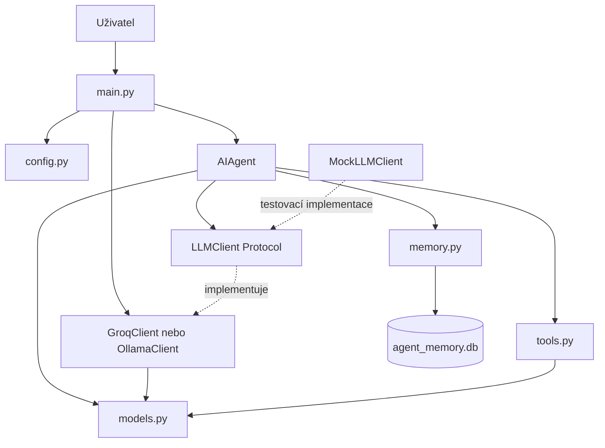
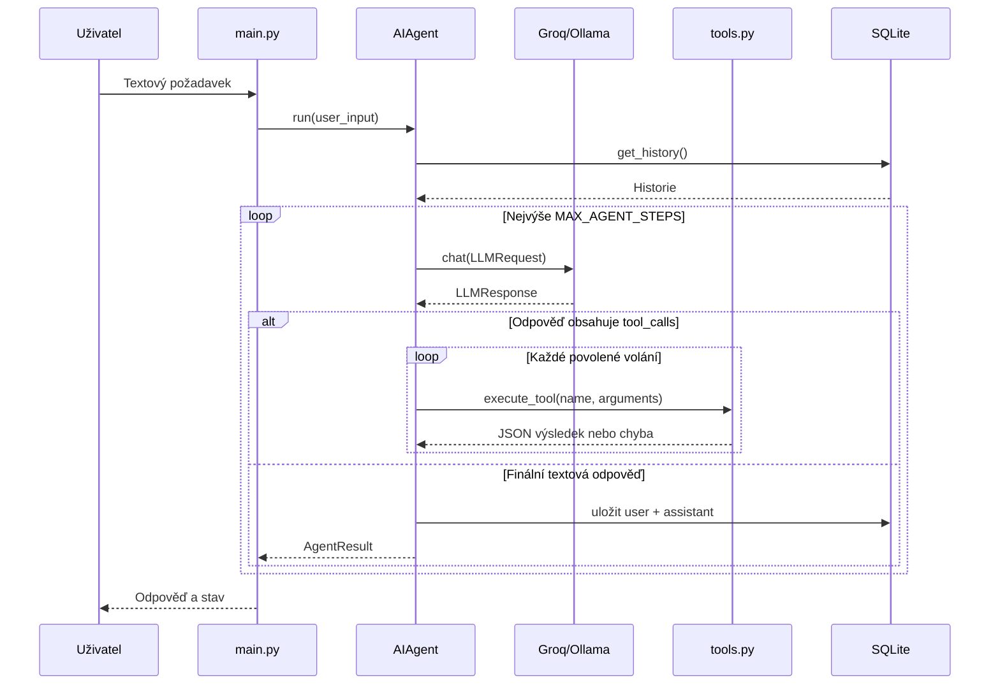

# Architektura AI agenta

## 1. Účel a architektonické principy

Aplikace je jednoduchý konzolový AI agent v Pythonu. Jejím hlavním architektonickým cílem je oddělit rozhodovací logiku agenta od konkrétního poskytovatele jazykového modelu.

Použité principy:

- **Separation of Concerns:** agent, adaptéry LLM, nástroje, paměť a konfigurace mají oddělené odpovědnosti.
- **Dependency Injection:** `AIAgent` dostává LLM klienta zvenčí; sám nevybírá poskytovatele.
- **Provider neutrality:** interní komunikace používá vlastní datové třídy, nikoliv datové struktury Groq nebo Ollama.
- **KISS:** projekt používá standardní knihovnu Pythonu a jednoduché funkce/dataclasses místo frameworku.
- **Testovatelnost:** `MockLLMClient` umožňuje testovat Agent Loop bez síťové komunikace.

Aktuální systém je jeden agent s několika nástroji. Není to multiagentní systém (MAS).

## 2. Přehled komponent

| Soubor | Odpovědnost |
|---|---|
| `main.py` | Vstupní bod aplikace, výběr poskytovatele a konzolová smyčka. |
| `config.py` | Cesty, konfigurace poskytovatelů, limity a system prompt. |
| `agent/models.py` | Provider-neutrální datový kontrakt. |
| `agent/agent.py` | Agent Loop, sestavení kontextu, vykonávání volání nástrojů a výsledek běhu. |
| `agent/llm_client.py` | `LLMClient` Protocol, `LLMError` a adaptér Ollama. |
| `agent/groq_client.py` | Adaptér Groq Chat Completions API. |
| `agent/tools.py` | Definice, registrace, validace a vykonávání nástrojů. |
| `agent/memory.py` | Dlouhodobá historie konverzace v SQLite. |
| `agent/mock_llm_client.py` | Deterministický klient pro testování. |
| `tests/` | Jednotkové testy agenta, adaptérů a nástrojů. |

## 3. Závislosti mezi komponentami



Schéma vyjadřuje logické vztahy. `LLMClient` je `Protocol`, tedy strukturální rozhraní: klient nemusí dědit ze společné základní třídy, musí pouze poskytovat kompatibilní metodu `chat`.

## 4. Provider-neutrální datový kontrakt

Interní datové třídy jsou definovány v `agent/models.py`. Jejich účelem je zajistit, aby agent pracoval se stejnou strukturou bez ohledu na to, zda komunikuje s Groq, Ollama nebo testovacím klientem.

### `ChatMessage`

Reprezentuje jednu zprávu v konverzaci:

- `role`: `system`, `user`, `assistant` nebo `tool`;
- `content`: text zprávy, případně `None`;
- `tool_calls`: seznam požadavků asistenta na spuštění nástrojů;
- `tool_call_id`: identifikátor volání, ke kterému patří výsledek nástroje;
- `name`: název nástroje u výsledkové zprávy.

### `ToolCall`

Jedno volání nástroje požadované modelem:

- `id`: identifikátor volání;
- `name`: název registrovaného nástroje;
- `arguments`: argumenty ve formě slovníku.

### `ToolDefinition`

Provider-neutrální popis nástroje:

- `name`: název;
- `description`: popis účelu;
- `parameters`: schéma parametrů ve formátu JSON Schema.

### `LLMRequest` a `LLMResponse`

`LLMRequest` obsahuje seznam `ChatMessage` a volitelný seznam `ToolDefinition`. `LLMResponse` obsahuje text odpovědi a/nebo seznam `ToolCall`.

### Rozhraní `LLMClient`

V `agent/llm_client.py` je definován protokol:

```python
class LLMClient(Protocol):
    def chat(self, request: LLMRequest) -> LLMResponse:
        ...
```

Agent předá adaptéru `LLMRequest` a očekává normalizovaný `LLMResponse`. Převod na formát konkrétního API patří výhradně do adaptéru.

## 5. Adaptéry poskytovatelů

### Groq – `agent/groq_client.py`

- Používá Groq Chat Completions API na adrese definované v `GROQ_URL`.
- Výchozí model je `openai/gpt-oss-120b`.
- Převádí interní zprávy a definice nástrojů do OpenAI-kompatibilního formátu.
- Z odpovědi extrahuje text a volání nástrojů a převádí je na `LLMResponse` a `ToolCall`.
- API klíč získává z proměnné prostředí `GROQ_API_KEY`.

### Ollama – `agent/llm_client.py`

- Je volitelným lokálním adaptérem.
- Používá výchozí endpoint `http://localhost:11434/api/chat` a model `qwen3:4b`.
- Převádí interní datové struktury na formát Ollama Chat API.
- Pokud odpověď Ollama neobsahuje ID volání nástroje, adaptér vytvoří lokální identifikátor.

### Chyby komunikace

`LLMError` je společná výjimka pro chyby komunikace s jazykovým modelem a neplatné odpovědi poskytovatele. Adaptéry zpracovávají HTTP chyby, síťové chyby typu `OSError`, timeouty a chybná JSON data. Opakování požadavku je omezeno parametrem `max_retries`. Agent navíc zachytává neočekávané výjimky cizího LLM klienta a kontroluje typ i základní strukturu `LLMResponse` před jejím zpracováním. Uživateli vrací obecnou zprávu, podrobnosti zapisuje přes `logging` do lokálního `agent.log`; tento soubor není verzován.

## 6. Tok jednoho požadavku

1. `main.py` načte `LLM_PROVIDER` a vytvoří `GroqClient` nebo `OllamaClient`.
2. `AIAgent` dostane klienta v konstruktoru. Pokud není klient předán, konstruktor vyhodí `ValueError`.
3. Uživatel zadá text v konzoli.
4. `AIAgent.run()` ověří vstup a sestaví kontext: system prompt, uloženou historii a aktuální uživatelskou zprávu.
5. Agent vytvoří `LLMRequest` a zavolá `llm_client.chat()`.
6. Adaptér převede požadavek do formátu svého API a odešle jej poskytovateli.
7. Adaptér normalizuje odpověď na `LLMResponse`.
8. Pokud odpověď obsahuje volání nástrojů, agent je vykoná a přidá výsledkové zprávy do dočasného kontextu.
9. Agent znovu zavolá model s aktualizovaným kontextem.
10. Jakmile model vrátí text bez volání nástrojů, agent vytvoří `AgentResult` a pokusí se uložit uživatelský vstup a finální odpověď do SQLite. Chyba paměti neblokuje odpověď; projeví se samostatným upozorněním v `AgentResult.memory_warning`.



## 7. Agent Loop a limity

Agent Loop je implementován v `AIAgent.run()`.

Konfigurované limity v `config.py`:

| Konstanta | Výchozí hodnota | Význam |
|---|---:|---|
| `MAX_AGENT_STEPS` | 8 | Maximální počet požadavků modelu v jednom běhu agenta. |
| `MAX_TOOL_CALLS` | 12 | Maximální počet vykonaných volání nástrojů v jednom běhu. |
| `MAX_HISTORY_MESSAGES` | 12 | Počet posledních zpráv načítaných z SQLite. |
| `MAX_FILE_SIZE` | 100 000 bajtů | Maximální počet bajtů načtených nástrojem `read_file`. |
| `MAX_LIST_FILES` | 500 | Maximální počet položek vrácených nástrojem `list_files`. |

Limity Agent Loop a volání nástrojů jsou nezávislé. Agent může skončit se stavem:

- `completed` – model vrátil neprázdnou konečnou odpověď;
- `error` – nastala chyba vstupu, komunikace nebo prázdná konečná odpověď;
- `limit_reached` – byl dosažen limit rozhodovacích kroků nebo volání nástrojů.

Potíže s dlouhodobou pamětí nemění `status` ani `error`; oznamují se samostatným polem `memory_warning`.

Počet volání nástrojů se vztahuje na vykonaná volání, nikoliv na počet cyklů.

## 8. Nástroje

Nástroje jsou definovány a registrovány v `agent/tools.py`.

### `calculator`

Podporuje operace `add`, `subtract`, `multiply` a `divide`. Kontroluje typ a rozsah čísel, odmítá booleovské hodnoty, neplatná čísla a dělení nulou. Výsledek vrací jako číslo.

### `list_files`

Vrací objekt obsahující relativní cesty souborů v `workspace/`, příznak `truncated` a použitý limit `max_results`. Vrací nejvýše `MAX_LIST_FILES` položek. Symbolické odkazy na soubory i adresáře ignoruje, aby výpis nepřecházel mimo pracovní prostor.

### `read_file`

Čte textový soubor v UTF-8 z `workspace/`. Kontroluje relativní cestu, zakazuje absolutní cesty, průchod do nadřazeného adresáře a symbolické odkazy. Obsah načítá binárně nejvýše do `MAX_FILE_SIZE + 1` bajtů a překročení limitu odmítne. Na systémech podporujících `O_NOFOLLOW` navíc odmítne symbolický odkaz v poslední komponentě při samotném otevření souboru. Tato ochrana neřeší všechny možné závody při souběžné změně nadřazených adresářů jiným lokálním procesem.

### Registr a vykonání

- `AVAILABLE_TOOLS` mapuje názvy na Python funkce.
- `TOOL_DEFINITIONS` obsahuje provider-neutrální popisy a JSON Schema parametrů.
- `execute_tool()` ověřuje název a typ argumentů, vykoná registrovanou funkci a vrací JSON text s klíčem `result` nebo `error`.

Model pouze navrhuje volání nástroje. Samotné vykonání provádí Python aplikace podle pevného registru; model nemůže tímto rozhraním spouštět libovolné funkce. Registr převádí očekávané chyby na JSON výsledek a neočekávané výjimky zaznamená do logu a nahradí bezpečnou chybovou zprávou. Agent má navíc ochrannou hranici kolem volání registru, aby neočekávaná chyba nástroje nepřerušila Agent Loop.

## 9. Paměť a historie

`agent/memory.py` implementuje jednoduchou dlouhodobou paměť pomocí SQLite.

- Databáze je `agent_memory.db` v kořenovém adresáři projektu.
- Databáze a její SQLite journal/WAL soubory jsou ignorovány pomocí `.gitignore`, protože mohou obsahovat soukromou historii.
- Tabulka `conversation` uchovává `id`, `role`, `content` a `created_at`.
- Ukládají se pouze zprávy rolí `user` a `assistant`.
- `get_history()` načítá posledních `MAX_HISTORY_MESSAGES` záznamů a vrací je chronologicky.
- `save_exchange()` ukládá uživatelský vstup a odpověď asistenta v jedné transakci; při chybě se neuloží ani jedna zpráva.
- Při sestavení kontextu se načtené záznamy převedou na interní `ChatMessage`.
- Inicializace, načtení ani uložení paměti nejsou podmínkou běhu agenta. Při chybě pokračuje bez historie a vrací uživatelské upozornění v poli `memory_warning`.

Výsledky nástrojů a mezilehlé zprávy asistenta s `tool_calls` se do SQLite neukládají; existují pouze v kontextu aktuálního běhu.

Současná paměť je jedna společná historie bez oddělení uživatelů nebo konverzačních vláken. Limit posledních zpráv může uříznout dvojici uživatelské a asistentovy zprávy. Jde o jednoduché řešení pro výukového agenta, nikoliv o víceuživatelskou paměť.

## 10. Testování

- `tests/test_agent.py` ověřuje Agent Loop, přímou odpověď, volání jednoho i více nástrojů, limity, chybové stavy, validaci odpovědi LLM a ukládání historie.
- `tests/test_llm_clients.py` ověřuje převod interních dat do formátů Groq/Ollama, parsování simulovaných odpovědí a převod síťových chyb na `LLMError`.
- `tests/test_tools.py` ověřuje kalkulačku, registr nástrojů, bezpečné zpracování neočekávaných výjimek a omezení přístupu k souborům.

`MockLLMClient` vrací předem připravené `LLMResponse`, zaznamenává požadavky a umožňuje testovat rozhodovací logiku bez skutečného modelu.

Automatické testy adaptérů používají simulované HTTP odpovědi. Nepotvrzují proto aktuální dostupnost Groq ani lokální instalace Ollama. Při aktualizaci API poskytovatele je nutné ověřit také skutečnou komunikaci.

## 11. Bezpečnostní hranice a známá omezení

- API klíč Groq se načítá z proměnné prostředí; nesmí být vložen do repozitáře.
- Nástroj pro soubory je omezen na `workspace/` a limit velikosti.
- Obsah souborů je system promptem označen jako nedůvěryhodná data, nikoliv jako nové instrukce agenta.
- Nejsou implementovány obecné shell příkazy ani vykonávání kódu generovaného modelem.
- Validace cest a symlinků snižuje riziko neoprávněného přístupu, ale sama o sobě není úplným bezpečnostním auditem. Zejména je třeba mít na paměti možné závody mezi kontrolou cesty a otevřením souboru (TOCTOU).
- Odpověď modelu může být věcně neúplná, i když nástroje proběhnou správně. Příklad: model provedl dva výpočty, ale ve finální odpovědi uvedl pouze druhý výsledek.
- SQLite paměť je best-effort služba: chyba inicializace, čtení nebo zápisu neblokuje dokončení požadavku. Agent pokračuje bez historie a vrací `memory_warning`; technický detail je dostupný při zapnutém logování.
- Chyba LLM klienta vede k bezpečnému výsledku `error`; neočekávaná chyba nástroje je převedena na chybový JSON výsledek, takže model může rozhodnout, jak pokračovat. Technické detaily se zaznamenávají přes `logging` do lokálního `agent.log`.
- Ukládání dvojice uživatelská zpráva + odpověď probíhá atomicky v jedné transakci. Pokud jedna část selže, transakce se vrátí zpět.

## 12. Možný další rozvoj

Následující body jsou návrhy, nikoliv implementované funkce:

1. Strukturované výstupy a validace datových odpovědí modelu.
2. Přísnější validace interního datového kontraktu a odpovědí adaptérů.
3. Vylepšení paměti – oddělené konverzace a zachování úplných dvojic zpráv.
4. Testy kvality finálních odpovědí, zejména úplnosti výsledků po více voláních nástrojů.
5. Další LLM adaptér, pokud bude potřeba, bez změny Agent Loop.
6. Teprve po dokončení základů jednoho agenta rozšíření na specializovaného programátorského agenta a později na MAS.

Rozšiřování o další poskytovatele nebo agenty nesmí vést ke smíchání herního projektu Magnum Opus s tímto vývojovým nástrojem. Jde o dva samostatné softwarové projekty.
